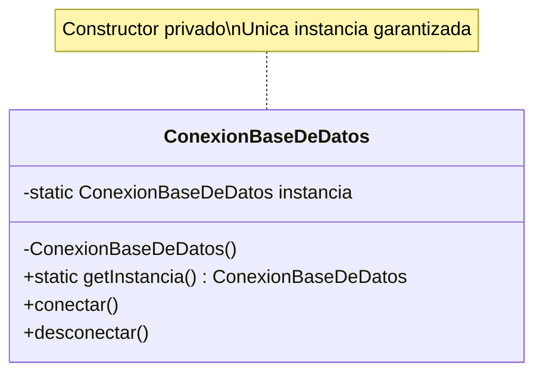

---

<a id="patrones-de-diseno"></a>

# Patrones de Diseño en Java

## Clasificación por Tipo

Los patrones de diseño se dividen en tres categorías principales según su propósito:

| Categoría | Propósito |
|-----------|-----------|
| **Creacionales** | Controlan el proceso de creación de objetos |
| **Estructurales** | Definen cómo se componen y relacionan las clases y objetos |
| **De Comportamiento** | Definen cómo los objetos se comunican y distribuyen responsabilidades |

<a id="10-patrones-creacionales"></a>

## — Patrones Creacionales —

<a id="10-patron-singleton"></a>

# 10. Singleton

## ¿Qué es?

El patrón **Singleton** garantiza que una clase tenga **una única instancia** en toda la aplicación y proporciona un punto de acceso global a ella.

## ¿Qué problema soluciona?

Evita la creación múltiple de objetos que consumen muchos recursos (como conexiones a bases de datos, manejadores de logs o fábricas de hilos). Sin Singleton, cada vez que se solicitara una instancia de estos objetos, se crearía una nueva, desperdiciando memoria y recursos.

## Ejemplo en Java

```java
public class ConexionBaseDeDatos {
    private static volatile ConexionBaseDeDatos instancia;
    private ConexionBaseDeDatos() { }
    
    public static ConexionBaseDeDatos getInstancia() {
        if (instancia == null) {
            synchronized (ConexionBaseDeDatos.class) {
                if (instancia == null) {
                    instancia = new ConexionBaseDeDatos();
                }
            }
        }
        return instancia;
    }
}
```

## Diagrama de Clases



**Uso en Spring:** Los beans con scope `@Singleton` (por defecto) siguen este patrón.
